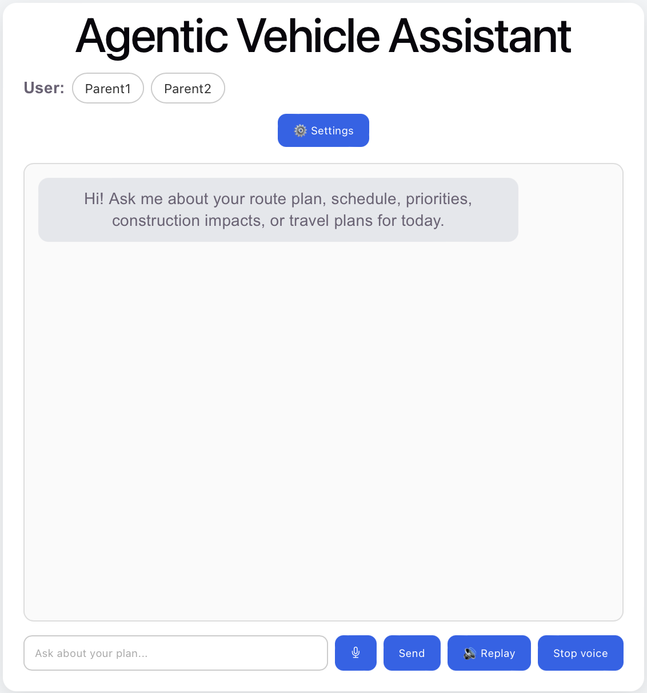
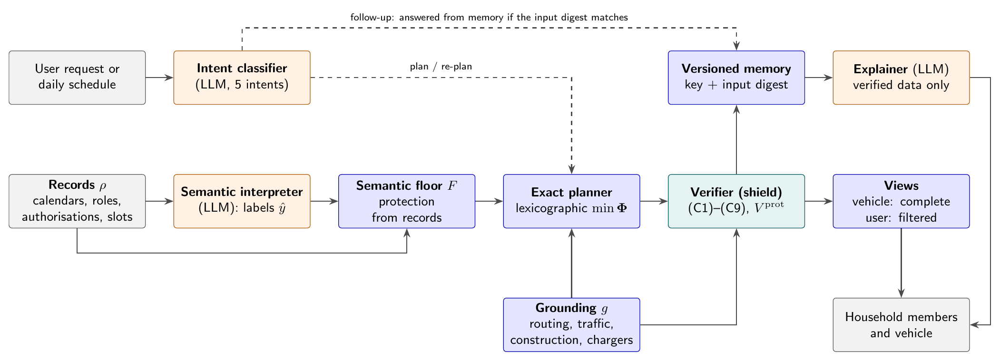

# Agentic Mobility Assistant

Household travel coordination with bounded language-model interpretation, deterministic planning, and independent verification.

Developed by Olivia Cardillo and Jiangbo Yu at McGill University.



## Overview

Coordinating a household's travel day with one shared electric vehicle requires more than finding routes. Work commitments, school pickups, caregiver availability, charging needs, and road disruptions all affect whether a daily schedule is feasible.

This repository brings together two related parts of the project:

1. A conversational mobility prototype built with React and n8n, integrating calendars, traffic-aware routing, construction information, charging information, and route memory.
2. An **Interpret–Solve–Verify (ISV)** research implementation that formalizes household missions, constructs plans with lexicographic branch-and-bound, and independently checks operational and protected-commitment constraints.

The ISV planner and verifier have been evaluated computationally. Their complete end-to-end integration with the deployed n8n workflow remains future work; vehicle movements in the ISV experiments are simulated.

## Interpret–Solve–Verify architecture



| Stage                | Responsibility                                                                                                                    |
| -------------------- | --------------------------------------------------------------------------------------------------------------------------------- |
| Interpret            | A bounded LLM classifies requests, interprets event labels, and prepares explanations.                                            |
| Protect              | A deterministic semantic floor derives protected dependent commitments from source records.                                       |
| Ground               | Calendar data, household settings, routing information, charging information, and construction data provide authoritative inputs. |
| Solve                | A lexicographic branch-and-bound planner constructs a household vehicle mission, with a configurable computation time limit.      |
| Verify               | An independent verifier checks constraints C1–C9 and reports any outstanding violations.                                         |
| Explain and remember | The system produces household-facing and vehicle-facing views, with input-versioned route memory for follow-up questions.         |

A mission includes vehicle stops, departure and arrival times, passenger movements, caregiver assignments, and charging. Calendar adjustments are recommendations requiring household approval.

Verification claims are conditional on complete mediation, integrity of source records and grounded inputs, and the verifier correctly evaluating the modeled constraints. A time-limited search can return its best available mission without proving global optimality.

## Research evaluation

The computational experiments use generated household scenarios with a travel-time model calibrated from eight TomTom-routed legs in the original Montréal case study. The synthetic experiments do not run live traffic queries or execute physical vehicle actions.

| Evaluation              | Scope                                                      | Main purpose                                                                                                          |
| ----------------------- | ---------------------------------------------------------- | --------------------------------------------------------------------------------------------------------------------- |
| Field prototype         | One Montréal household scenario, three runs per condition | Assess the original n8n/LLM workflow with a route-quality rubric.                                                     |
| Planning benchmark (E2) | 1,000 synthetic household days                             | Compare chronological replay (L0), context-aware rules (L1), deployed-rule approximation (L2), and ISV planning (L3). |
| Agency × autonomy (E3) | 300 synthetic household days                               | Examine planning performance under human-driven and automated-vehicle/escort settings.                                |
| Error containment (E4)  | 150 days at four injected-error rates                      | Compare architectures under controlled interpretation, transcription, and numerical errors.                           |
| Sensitivity (E5)        | 100 synthetic days per factor setting                      | Study initial charge, construction, and caregiver pickup authorization.                                               |

### Selected results

On the 1,000-day synthetic planning benchmark (automated vehicle):

| Planner                           | Feasible days | Protected commitments served |
| --------------------------------- | ------------: | ---------------------------: |
| L0 · Calendar replay             |         20.7% |                        85.4% |
| L1 · Context-aware               |         65.3% |                        76.1% |
| L2 · Deployed-rule approximation |         65.5% |                        76.5% |
| L3 · ISV planner                 |         88.4% |                        94.0% |

The ISV planner had a median solve time of 0.21 seconds; 5.7% of benchmark days reached its 20-second computation limit. These results measure feasibility under the implemented household model and verifier.

The earlier Montréal prototype received a mean route-quality rubric score of 94.44%, compared with 75.00% for an LLM-only baseline and 72.22% for a calendar-tool agent. These field rubric scores and synthetic feasibility rates are different metrics and should not be compared directly.

Controlled error-injection results are available under [`results/`](results/). They do not establish the real-world error distribution of a particular LLM. The [`docs/llm_benchmark.md`](docs/llm_benchmark.md) harness supports additional experiments with actual model outputs.

## Repository layout

```text
agentic-mobility-assistant/
├── frontend/               React + Vite conversational interface
├── workflow/               Sanitized n8n prototype workflow and setup notes
├── hmplan/                 Household mission model, planner, verifier, semantics, memory
│   └── llm/                Bounded LLM pipelines and provider adapters
├── service/                Local HTTP API: /health, /floor, /plan, /verify
├── experiments/            Benchmark runners, figures, tables, LLM evaluation harness
├── tests/                  Python tests for planning, verification, and memory
├── examples/               Example Montréal household planning request
├── results/                Saved experiment outputs and generated figures
├── docs/                   Reproducibility, integration guide, and demonstration media
├── requirements.txt        Optional Python dependencies for experiments and tests
└── CITATION.cff             Citation metadata
```

## Getting started

Run the following commands from the repository root unless otherwise indicated.

### 1. Python planning core

Requires Python 3.10 or newer. The core [`hmplan/`](hmplan/) package uses the Python standard library; the extra packages in `requirements.txt` support tests and research outputs.

```bash
python3 -m venv .venv
source .venv/bin/activate          # macOS / Linux
python -m pip install -r requirements.txt
python -m pytest -q tests
```

Run the Montréal planning case and its counterfactuals:

```bash
python experiments/run_experiments.py case
```

### 2. Launch the local ISV service

In another terminal, from the repository root:

```bash
python service/server.py --port 8787
```

Check the health endpoint:

```bash
curl http://127.0.0.1:8787/health
```

Submit a sample planning request:

```bash
curl -X POST http://127.0.0.1:8787/plan \
  -H 'Content-Type: application/json' \
  --data-binary @examples/montreal_run2_request.json
```

The service supports `POST /plan`, `POST /verify`, `POST /floor`, and `GET /health`. The example includes an `instance` object and a planning time limit. See [`service/server.py`](service/server.py) and [`docs/n8n_integration.md`](docs/n8n_integration.md) for the request and response structures.

The default service binds to `127.0.0.1` and does not implement authentication. Keep it private or add appropriate access controls before exposing it to other machines.

### 3. Run the React frontend

Requires Node.js and npm versions compatible with the included Vite toolchain.

```bash
cd frontend
npm ci
cp .env.example .env
npm run lint
npm run build
npm run dev
```

Configure the following variables in `frontend/.env` before using live conversational features:

```dotenv
VITE_CHAT_WEBHOOK_URL=https://your-n8n-host/webhook/your-chat-endpoint
VITE_SETTINGS_WEBHOOK_URL=https://your-n8n-host/webhook/user-settings
```

The frontend calls n8n webhook endpoints. Running React locally does not automatically start or connect an n8n instance. Never commit a real `.env` file or private credentials.

**Full conversational experience requires a configured n8n instance** with your own OpenAI and/or Gemini, Google Calendar, TomTom (routing, geocoding, and traffic), and weather-service credentials. Import the sanitized workflow at [`workflow/agentic-mobility-assistant-workflow-public.json`](workflow/agentic-mobility-assistant-workflow-public.json), then configure its credentials, household settings, and n8n data tables. The frontend alone provides the interface; it cannot deliver the full connected mobility experience without these services.

For Vercel deployments, set the project root directory to `frontend`, the build command to `npm run build`, and the output directory to `dist`. Configure the webhook environment variables in the deployment platform.

### 4. Import the existing n8n workflow

The sanitized prototype export is located at:

[`workflow/agentic-mobility-assistant-workflow-public.json`](workflow/agentic-mobility-assistant-workflow-public.json)

Import it into an n8n instance and configure the required service credentials and data tables. The original workflow uses Google Calendar, TomTom routing/geocoding/traffic, construction information, charging data, weather, and LLM providers. Its planning agent currently performs mission-generation work that the ISV architecture proposes to move to the deterministic planner.

The step-by-step migration is documented in [`docs/n8n_integration.md`](docs/n8n_integration.md). The JSON export is the existing prototype; it is not a fully integrated ISV deployment.

## Reproducing the experiments

The larger experiments can take substantial computation time because the planner has a per-instance time limit. The scripts support reproducible seeds and saving or resuming results.

```bash
python experiments/run_experiments.py bench --n 1000
python experiments/run_experiments.py autonomy --n 300
python experiments/run_experiments.py errors --n 150
python experiments/run_experiments.py sensitivity --n 100
python experiments/make_figures.py
python experiments/export_latex.py --out paper/
```

Use `--procs` to control worker processes and `--fresh` to regenerate a dataset from the beginning. Saved results, tables, and figure files are provided in [`results/`](results/). See [`docs/reproducibility.md`](docs/reproducibility.md) for additional details.

### Evaluating LLM interpretation

An offline mock-provider run requires no API key:

```bash
python experiments/run_llm_benchmark.py --mock --n 3
```

To evaluate an actual provider, set its API key and select the appropriate model:

```bash
export OPENAI_API_KEY='your-key'
python experiments/run_llm_benchmark.py --models openai:gpt-5.2 --n 10 --repeats 1
```

OpenAI, Gemini, and Anthropic provider adapters are included. Live provider calls may incur charges, and model identifiers or API requirements may change. The real-LLM evaluation harness is separate from the controlled error-injection results described above.

## Demonstration and research resources

- [Original demonstration paper](docs/demo/AAAI27_Demonstration_Paper.pdf)
- [Demonstration video](docs/demo/AAAI27_Demonstration_Video_Compressed.mp4)
- [Household travel timeline](docs/images/household-timeline.png)
- [Construction-aware rerouting](docs/images/construction-rerouting.png)
- [Experimental reproducibility guide](docs/reproducibility.md)
- [Field-evaluation results status](results/field/README.md)

The summary field-evaluation scores are documented, but the underlying per-run field logs listed in `results/field/README.md` have not yet been added to the repository.

## Validation and limitations

In the current development verification, the Python test suite passed 8 tests; the frontend passed ESLint and a production Vite build; and `npm audit --omit=dev` reported zero production dependency vulnerabilities. These checks do not substitute for deployment-specific integration testing or an audit of development dependencies.

The evaluation uses a modeled single-vehicle household setting, discretized planning actions, calibrated travel times, and simulated vehicle movements. The ISV planner and verifier have not yet been validated end to end with live n8n executions, real household users, and physical vehicle controls.

## Citation

If you use this software, planning framework, or benchmark in research, please cite the associated manuscript. The citation included in the original project README is reproduced here:

```bibtex
@article{cardillo_yu_isv,
  title   = {Interpret, solve, Verify: A bounded-agency language-model assistant for coordinating
             household travel with a shared electric vehicle},
  author  = {Cardillo, Olivia and Yu, Jiangbo},
  journal = {Transportation Research Part C: Emerging Technologies},
  note    = {Submitted},
  year    = {2026}
}
```

## License

Released under the [MIT License](LICENSE). Third-party APIs and data services remain subject to their own terms. Do not publish household calendar records, account tokens, webhook credentials, or other personal information with reproducibility artifacts.
